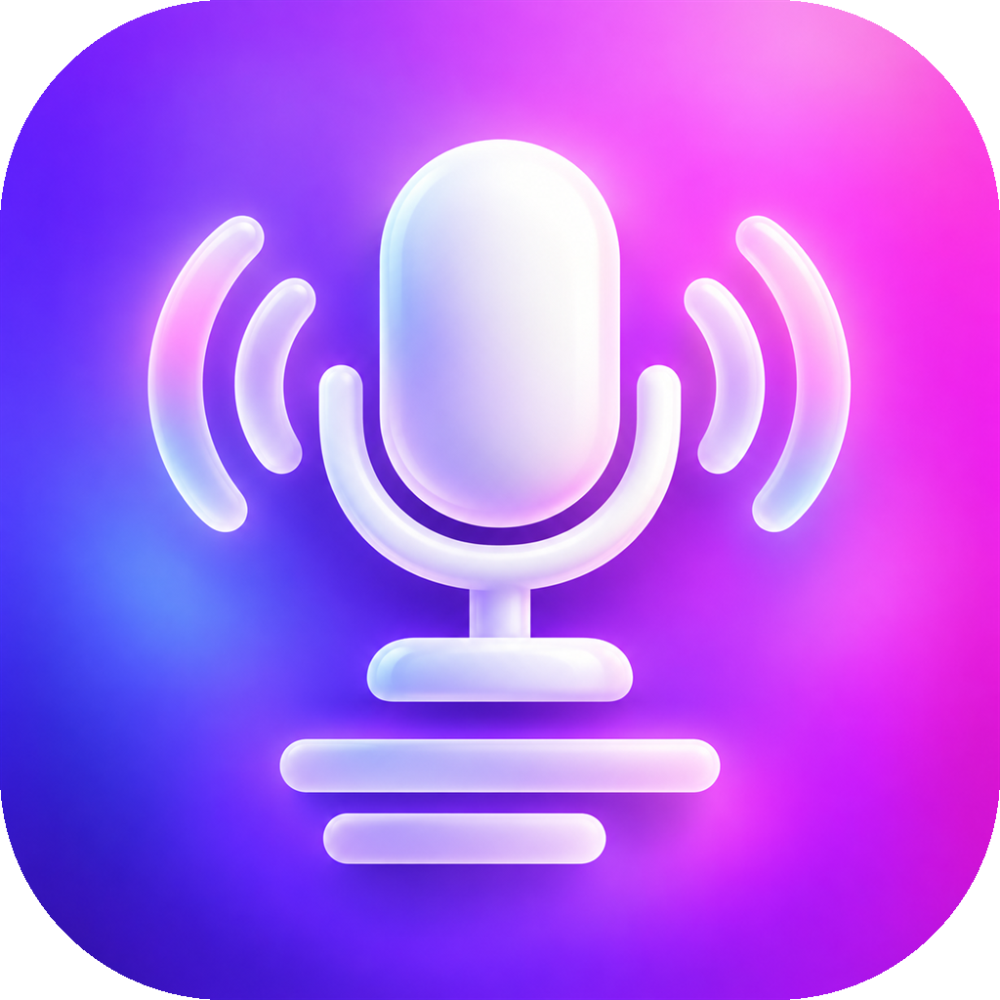
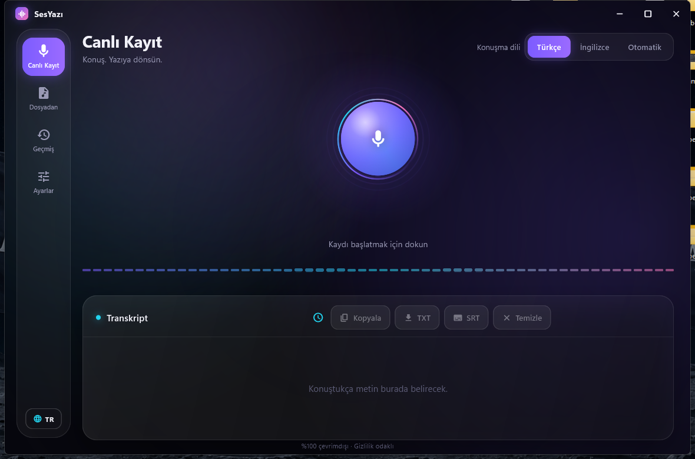
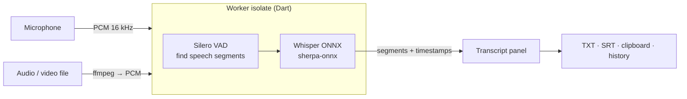

<div align="center">



# Voice Scribe

**Offline speech-to-text for your desktop.** Record from the microphone or drop an audio / video file and get an accurate transcript —
Turkish, English or auto-detect — **without your audio ever leaving your computer.**


[Features](#-features) · [Install](#-install) · [Using it](#-using-it) · [Models](#-models) · [How it works](#-how-it-works) · [Privacy](#-privacy) · [FAQ](#-faq) · [Build](#-build-from-source) · [Türkçe özet](#-türkçe-özet)

<br>



</div>

---

## ✨ Features

| | |
|---|---|
| 🎙️ **Live recording** | Real-time transcript while you speak, with a level meter and speech detection |
| 📁 **From file** | Drag & drop or browse: MP3 · WAV · M4A · FLAC · OGG · MP4 · MKV · MOV · WEBM … |
| 📝 **Export** | Copy to clipboard, save **TXT**, or **SRT** subtitles; optional timestamps |
| 🕘 **History** | Every transcript is kept locally; reopen, copy, export or delete |
| 🧠 **Three model sizes** | *Fast · Balanced · Accurate* — pick speed or accuracy |
| 🌍 **Languages** | Turkish, English or **auto-detect**; interface in English and Türkçe |
| 🔒 **Truly offline** | After the one-time model download nothing needs the internet |
| 🪟 **Polished desktop UI** | Custom title bar, animated aurora background, drag & drop everywhere |

## 📦 Install

**Installer (recommended)** — download `VoiceScribe-Setup-<version>.exe` from [Releases](../../releases). It installs per-user
(no admin rights) and needs **no prerequisites**.

**First launch:** Voice Scribe asks to download one speech model (and a tiny voice-activity model). Choose *Accurate* for Turkish.
For file transcription it can also fetch **ffmpeg** (Settings → *File decoder*) to read video and audio containers.

> Requirements: Windows 10/11 (macOS builds from source), a microphone for live recording, ~400 MB free disk for the *Accurate* model.

## 🚀 Using it

1. **Live Record** — pick the speech language (top right), press the big microphone, talk. Text appears as sentences finish.
   Press stop; save or copy the transcript.
2. **From File** — drop a file on the window (or *Choose file*). Progress shows while it transcribes; press *Cancel* any time.
3. **History** — everything you transcribed, newest first.
4. **Settings** — choose / download models, install ffmpeg, pick the microphone, open the recordings / transcripts folders, switch UI language.

Tips for the best accuracy: use the *Accurate* model for Turkish, speak close to the microphone, set the language explicitly
instead of *Auto* when you know it, and prefer lossless audio (WAV / FLAC) when you have a choice.

## 🧠 Models

| Model | Name in app | Download | Best for |
|---|---|---|---|
| Whisper **tiny** (int8) | Fast | ≈ 100 MB | quick drafts, weak hardware |
| Whisper **base** (int8) | Balanced | ≈ 160 MB | everyday English |
| Whisper **small** (int8) | Accurate | ≈ 375 MB | **recommended for Turkish** |

Models are OpenAI Whisper weights converted to ONNX (int8) by the sherpa-onnx project and downloaded once from Hugging Face.
Speech segmentation uses the Silero VAD model.

## 🏗 How it works



* **UI isolate** — Flutter UI, state (`lib/state/app_state.dart`), recording via the `record` package.
* **Worker isolate** (`lib/engine/asr_worker.dart`) — owns the sherpa-onnx recognizer and the VAD, so the interface never freezes
  while a long file is transcribed.
* **File jobs** (`lib/engine/engine.dart`) decode with ffmpeg to 16 kHz mono PCM and stream it to the worker.
* **Export** (`lib/engine/export.dart`) builds TXT and SRT.

## 🔒 Privacy

* Audio and transcripts are processed **on your device only**; there is no account, telemetry or cloud service.
* Network use: the one-time downloads of models (Hugging Face / GitHub) and, optionally, ffmpeg (gyan.dev builds).
* Where things are stored:

| What | Where |
|---|---|
| Models, ffmpeg | `%APPDATA%\com.voicescribe\VoiceScribe\` (app support folder) |
| Recordings & transcripts | `Documents\VoiceScribe\Recordings` and `…\Transcripts` |
| Preferences | OS preferences store (UI language, model, speech language) |

## ❓ FAQ

<details><summary><b>Is it really offline?</b></summary>
Yes. Once the model is downloaded you can disconnect from the internet.
</details>

<details><summary><b>Why does the first transcription take a moment?</b></summary>
The model is loaded into memory once per session. Larger models need a few seconds.
</details>

<details><summary><b>Can it transcribe video?</b></summary>
Yes — install ffmpeg from Settings (one click) and drop an MP4 / MKV / MOV / WEBM.
</details>

<details><summary><b>Microphone not detected / permission denied</b></summary>
Allow microphone access in <i>Windows Settings → Privacy &amp; security → Microphone</i> (desktop apps) and pick the device in Voice Scribe's Settings.
</details>

<details><summary><b>Other languages?</b></summary>
Whisper supports many languages and the engine can run them; the app currently exposes Turkish, English and auto-detect. Adding more is a small change in <code>lib/state/app_state.dart</code> — PRs welcome.
</details>

## 🔧 Build from source

Requirements: [Flutter](https://docs.flutter.dev/get-started/install) with Windows (or macOS) desktop support.

```bash
git clone https://github.com/GingerSugar06/VoiceScribe.git
cd VoiceScribe
flutter pub get
flutter test
flutter run -d windows
flutter build windows --release
```

**Installer:** `powershell -ExecutionPolicy Bypass -File tool\make_installer.ps1`
(needs [Inno Setup 6](https://jrsoftware.org/isinfo.php)). **Icon:** edit `assets/icon/app_icon.svg` or drop
`assets/icon/source.png`, then `python tool/make_icon.py`.

### Project layout

```
VoiceScribe/
├─ lib/
│  ├─ main.dart            window, title bar, shell, navigation
│  ├─ l10n.dart            TR/EN strings
│  ├─ engine/              asr_worker (isolate), engine (live + file jobs), models (downloads), export (TXT/SRT)
│  ├─ state/app_state.dart app state, history, settings
│  └─ ui/                  pages (record, file, history, settings, setup), transcript panel, visual effects
├─ integration_test/       engine smoke test
├─ test/                   unit tests
├─ installer/              Inno Setup script
└─ tool/                   make_installer.ps1, make_icon.py
```

## 🤝 Contributing

Issues and pull requests are welcome — please run `flutter analyze` and `flutter test` first.

## 🇹🇷 Türkçe özet

**Voice Scribe**, tamamen **çevrimdışı** çalışan bir konuşmadan-yazıya uygulamasıdır: mikrofondan canlı kayıt yap ya da ses/video
dosyası bırak, Türkçe / İngilizce / otomatik algılamayla yazıya dönsün. Ses verin bilgisayarından çıkmaz. İlk açılışta bir kez model
indirilir (Türkçe için *Doğru* modeli öneririz). Sonuçları panoya kopyalayabilir, **TXT** ya da **SRT** altyazı olarak
kaydedebilirsin; geçmiş yerel olarak saklanır. Arayüz Türkçe ve İngilizce.

## ⚖️ Credits & license

[MIT](LICENSE). Built on [sherpa-onnx](https://github.com/k2-fsa/sherpa-onnx) (Apache-2.0), OpenAI Whisper weights (MIT),
Silero VAD (MIT) and ffmpeg (downloaded at runtime, not bundled). Fonts and icons are described in `assets/`.
